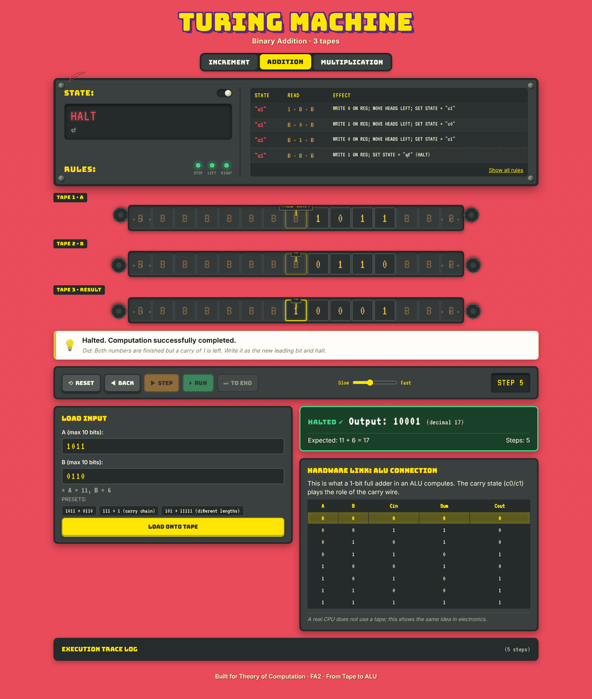
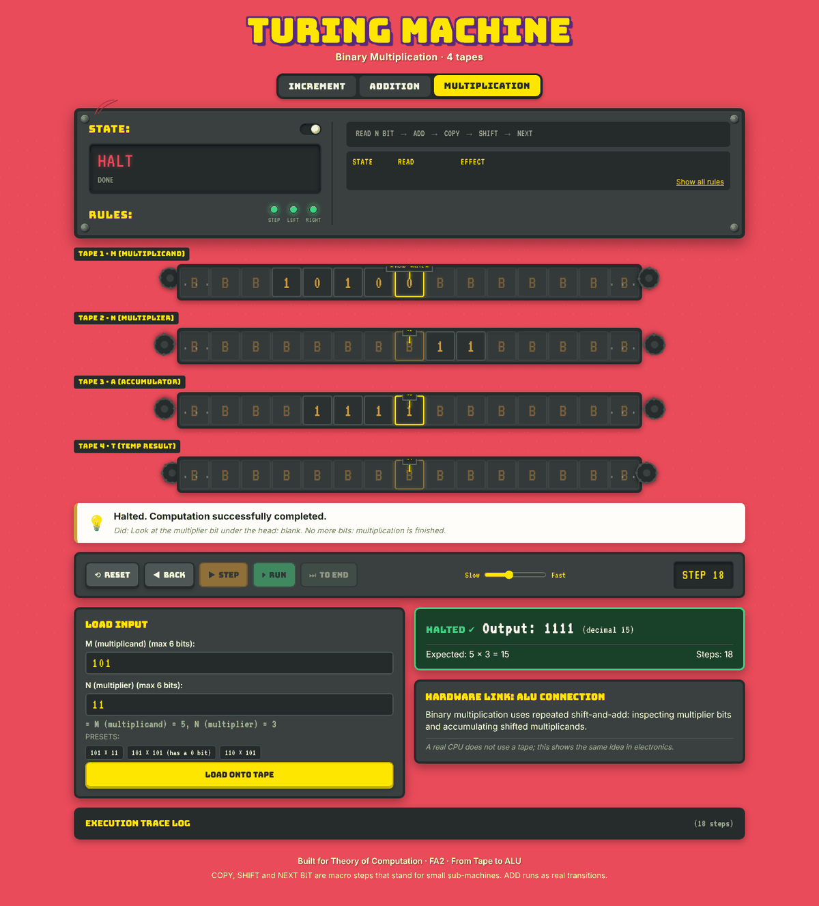

# Turing Machine Arithmetic Simulator

[](https://github.com/RohitDSonawane/turing-machine-arithmetic-simulator/actions/workflows/ci.yml)
[](LICENSE)

An interactive simulator that animates Turing machines doing binary arithmetic. It shows how the operations inside a CPU's arithmetic logic unit (ALU) come out of plain Turing machine transitions: increment is a chain of half-adders, addition is a full adder with the carry stored in the machine's state, and multiplication is shift-and-add.

Live demo: https://rohitdsonawane.github.io/turing-machine-arithmetic-simulator/



## Features

- Plain HTML, CSS and JavaScript (ES2019). There is no framework, no bundler, no build step and no runtime dependency.
- It runs from `index.html` opened straight from disk. Without a connection the web fonts fall back to system fonts, but everything else works.
- The interface looks like an arcade cabinet: a dark chassis with rivets, lamps for `STEP`, `LEFT` and `RIGHT`, a read/write head that slides along each tape, and rotating gears.
- A live 1-bit full adder truth table highlights the row that matches the current step, so you can see the circuit equivalent of each transition.
- An explain bar says in plain English what symbol was read, what was written, which way the heads moved and why the next state was chosen.
- Multiplication calls the 3-tape adder as a subroutine, which shows one automaton built from another.

## Machines

| Machine | Tapes | Algorithm | Hardware link |
|---|---|---|---|
| Binary increment | 1 (`NUMBER`) | Scan right to the least significant bit, then walk left turning trailing `1`s into `0` until a `0` or a blank turns up. | Chain of half-adders, as in counters and program counters. |
| Binary addition | 3 (`A`, `B`, `RESULT`) | Align both operands at column 0 and add column by column moving left. The carry lives in the machine's state (`c0` or `c1`). | 1-bit full adder and the ALU carry wire. |
| Binary multiplication | 4 (`M`, `N`, `A`, `T`) | Shift-and-add in phases: `READ`, `ADD`, `COPY`, `SHIFT`, `NEXT`. The `ADD` phase runs the 3-tape adder as a subroutine. | Multiplier accumulator and barrel shifter. |



## Running it

Open `index.html` in any current browser:

```bash
start index.html       # Windows
open index.html        # macOS
xdg-open index.html    # Linux
```

Or serve the folder locally:

```bash
python -m http.server 8000
# then open http://localhost:8000
```

To publish it with GitHub Pages, go to Settings, then Pages, choose the `main` branch and the `/ (root)` folder, and save. No build is needed.

## Tests

`node tests/run.js` runs 14 test groups with no external packages. They cover the exact vectors from the spec, every input from 0 to 1023 for increment, and randomized pairs for addition and multiplication. GitHub Actions runs them on every push.

```text
Running Turing Machine simulator test suite...

  ✓ M0: Environment and namespaces initialized
  ✓ M1: Tape helpers getCell, setCell, stringToCells, normalise
  ✓ M1: Toy machine step and stepBack round-trip
  ✓ M1: Stuck detection with incomplete toy machine
  ✓ M1: Step limit guard (5000) on looping machine
  ✓ M2: Increment machine spec vectors & step counts
  ✓ M2: Increment machine exhaustive test 0..1023
  ✓ M2: Addition machine rule table completeness & uniqueness
  ✓ M2: Addition machine spec vectors & step counts
  ✓ M2: Addition machine 200 random pairs (0..300) with leading zeros
  ✓ M5: Multiplication slide example 101 × 11 takes exactly 18 steps
  ✓ M5: Multiplication spec vectors from 04-MACHINES.md §3
  ✓ M5: Multiplication history round-trip across macro and ADD steps
  ✓ M5: Multiplication 300 random pairs (0..63)

Tests completed: 14 passed, 0 failed.
```

## Keyboard controls

| Key | Action |
|---|---|
| `Space` | Run or pause |
| `→` | Step forward one transition |
| `←` | Step back one transition |
| `R` | Reset to the initial tape |

Shortcuts are ignored while an input field has focus.

## Project layout

```text
.
├── index.html          page structure
├── css/
│   └── styles.css      styles, animations and responsive layout
├── js/
│   ├── engine.js       generic deterministic multi-tape Turing machine engine
│   ├── machines.js     increment and addition specs and rule generators
│   ├── composite.js    multiplier, which delegates its ADD phase to the adder
│   ├── ui.js           DOM rendering, tape sliding and lamp pulses
│   └── main.js         event wiring, keyboard controls, presets and the run loop
├── tests/
│   └── run.js          standalone Node test runner
├── Documents/          scope, UI and engine specs, machine tables and task list
├── NOTES.md            design decisions
└── LICENSE
```

## Background

I built this for a Theory of Computation course. The topic was "From Tape to ALU: Arithmetic on Turing Machines", and the goal was a tool for demonstrating that basic computer arithmetic can run on deterministic Turing machines.

## License

MIT. See [LICENSE](LICENSE).
